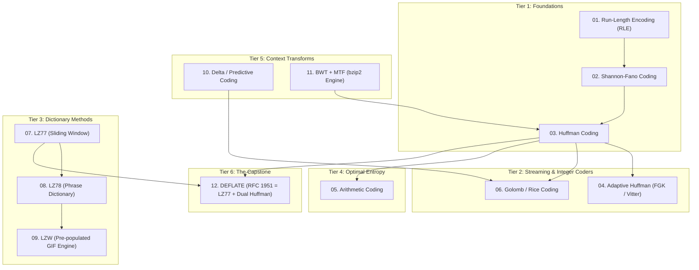

# Lossless Data Compression: From First Principles to DEFLATE

A comprehensive, pedagogical reference repository implementing the foundations, mathematics, and engineering of **lossless data compression** in Python.

From classic statistical entropy coding to sliding-window dictionaries, block-sorting transforms, and modern hybrid standards like RFC 1951 DEFLATE, each algorithm is documented with its theoretical motivation, step-by-step worked traces by hand, complexity analysis, and strict round-trip verification standards.

---

## 1. The Fundamental Theory: Shannon Limit & The Pigeonhole Principle

Lossless compression algorithms reduce data size without discarding a single bit of information:
$$\text{decode}(\text{encode}(x)) \equiv x \quad \forall x$$

### The Shannon Entropy Limit
Claude Shannon (1948) proved that for any discrete memoryless source $X$ emitting symbols from alphabet $\Sigma = \{s_1, \dots, s_K\}$ with probabilities $P(s_i)$, the minimum expected number of bits required to represent each symbol is bounded by the **Shannon Entropy** $H(X)$:

$$H(X) = -\sum_{i=1}^K P(s_i) \log_2 P(s_i)$$

- If an event occurs with probability $P(s)$, its self-information is $I(s) = -\log_2 P(s)$ bits.
- Huffman coding approximates $H(X)$ using integer bit lengths ($H(X) \le \bar{L} < H(X) + 1$).
- Arithmetic coding approaches $H(X)$ arbitrarily closely using fractional intervals.

### The Pigeonhole Principle (Why Universal Compression is Impossible)
A frequent misconception is that an algorithm could compress *any* file. By the Pigeonhole Principle, this is mathematically impossible:
- There are $2^{8N}$ possible files of size $N$ bytes.
- The total number of all possible files strictly smaller than $N$ bytes is $\sum_{k=0}^{N-1} 2^{8k} = \frac{2^{8N} - 1}{255} < 2^{8N}$.
- Therefore, no lossless algorithm can compress all inputs of length $N$. Any algorithm that shrinks some inputs **must expand others**.
- Testing on `data/random_bytes.bin` directly demonstrates this universal law.

---

## 2. Master Algorithm Taxonomy & Comparison

| # | Algorithm | Category | Core Mechanism | Best-Case Data | Pathological Case | Time Complexity | Real-World Use Cases | Directory |
| :-: | :--- | :--- | :--- | :--- | :--- | :--- | :--- | :--- |
| **01** | [**Run-Length Encoding (RLE)**](rle/README.md) | Run-Length | Replaces repeating runs with `(count, byte)` | Long uniform runs (`"AAAA..."`) | High-entropy alternating bytes (`"ABAB..."`) | $O(N)$ / $O(N)$ | Fax ITU-T T.4, BMP, TIFF, JPEG DC | [`rle/`](rle/) |
| **02** | [**Shannon-Fano Coding**](shannon_fano/README.md) | Statistical Entropy | Top-down recursive probability splitting | Skewed symbol frequencies | Uniform symbol distribution | $O(N + K \log K)$ / $O(N)$ | Historical benchmark, early ZIP (Implode) | [`shannon_fano/`](shannon_fano/) |
| **03** | [**Huffman Coding**](huffman/README.md) | Statistical Entropy | Bottom-up greedy min-heap prefix tree | Skewed frequencies | Uniform distribution ($P(x) = \frac{1}{K}$) | $O(N + K \log K)$ / $O(N)$ | JPEG, MP3, Gzip, Deflate, Unix compact | [`huffman/`](huffman/) |
| **04** | [**Adaptive Huffman**](adaptive_huffman/README.md) | Dynamic Entropy | Single-pass tree updates with Sibling Property | Non-stationary streaming text | Massive alphabet churn | $O(N \cdot \text{depth})$ / $O(N \cdot \text{depth})$ | Real-time network streams, ARC | [`adaptive_huffman/`](adaptive_huffman/) |
| **05** | [**Arithmetic Coding**](arithmetic/README.md) | Continuous Entropy | Maps message into fractional interval $[0.0, 1.0)$ | Probabilities with extreme skew ($P > 0.5$) | None (approaches theoretical entropy) | $O(N)$ / $O(N \log K)$ | JPEG 2000, H.264 / H.265 (CABAC) | [`arithmetic/`](arithmetic/) |
| **06** | [**Golomb-Rice Coding**](golomb_rice/README.md) | Integer Entropy | Unary quotient + binary remainder ($M = 2^k$) | Geometrically distributed integers / residuals | Uniformly high numbers | $O(N)$ / $O(N)$ | FLAC audio, Apple Lossless (ALAC), JPEG-LS | [`golomb_rice/`](golomb_rice/) |
| **07** | [**LZ77**](lz77/README.md) | Sliding Window Dict | Backwards pointers `(offset, length)` | Repetitive substrings across temporal window | Random or non-repeating data | $O(N \cdot L)$ / $O(N)$ | Gzip, ZIP, PNG, snappy, lz4 | [`lz77/`](lz77/) |
| **08** | [**LZ78**](lz78/README.md) | Phrase Dictionary | Trie-based explicit dictionary phrases | Growing repeated phrases | Uncorrelated data | $O(N)$ / $O(N)$ | Foundation of LZW, early modem protocols | [`lz78/`](lz78/) |
| **09** | [**LZW**](lzw/README.md) | Pre-populated Dict | Emits integer indices over pre-seeded 0–255 table | Redundant structured phrases | Alternating novel characters | $O(N)$ / $O(N)$ | GIF images, PDF Flate, Unix compress | [`lzw/`](lzw/) |
| **10** | [**Delta / Predictive**](delta/README.md) | Domain Transform | Replaces values with residuals $x_i - \hat{x}_i$ | Smoothly varying waveforms, sensor telemetry | Discontinuous white noise | $O(N)$ / $O(N)$ | PNG filters, FLAC LPC, Gorilla TSDB | [`delta/`](delta/) |
| **11** | [**BWT + MTF**](bwt_mtf/README.md) | Block Sorting Transform | Cyclic rotation sort + Move-to-Front + RLE | Repetitive context grammar (source code, logs) | High-entropy random blocks | $O(N \log N)$ / $O(N)$ | bzip2, Bowtie DNA alignment | [`bwt_mtf/`](bwt_mtf/) |
| **12** | [**DEFLATE**](deflate/README.md) | Hybrid (LZ77+Huffman) | LZ77 sliding window + Dual Dynamic Huffman trees | General prose, logs, structured files | Pure cryptographic random bytes | $O(N)$ / $O(N)$ | RFC 1951, gzip, zlib, ZIP, PNG, HTTP | [`deflate/`](deflate/) |

---

## 3. Pedagogical Learning Path

The repository is structured as a progressive curriculum arranged in increasing order of sophistication:



---

## 4. Repository Layout

```
lossless-compression/
├── README.md                      # Master curriculum, taxonomy, benchmarks, architecture
├── benchmarks/                    # Benchmark harness & comparative evaluation
│   └── README.md                  # Benchmark formulas, metrics, and methodology
├── data/                          # Standardized test corpus across entropy regimes
│   ├── README.md                  # Characterization of datasets
│   ├── repeated_runs.txt          # Long runs of identical bytes
│   ├── english_text.txt           # Natural language English prose
│   ├── structured_log.log         # Repetitive structured web server logs
│   ├── sensor_readings.csv        # Time-series telemetry (smooth drift)
│   └── random_bytes.bin           # Incompressible uniform PRNG bytes
│
├── rle/                           # Run-Length Encoding
│   ├── README.md                  # Worked example, PackBits, edge cases
│   └── tests/                     # Test suite directory
├── shannon_fano/                  # Shannon-Fano Coding
│   ├── README.md                  # Top-down recursive splitting & sub-optimality proof
│   └── tests/                     # Test suite directory
├── huffman/                       # Static Huffman Coding
│   ├── README.md                  # Bottom-up min-heap, canonical trees, worked trace
│   └── tests/                     # Test suite directory
├── adaptive_huffman/              # Dynamic Adaptive Huffman (FGK / Vitter)
│   ├── README.md                  # NYT node, sibling property, dynamic tree rebalancing
│   └── tests/                     # Test suite directory
├── arithmetic/                    # Arithmetic Coding
│   ├── README.md                  # Interval narrowing, integer renormalization (E1-E3)
│   └── tests/                     # Test suite directory
├── golomb_rice/                   # Golomb and Rice Coding
│   ├── README.md                  # Geometric distribution, unary/binary split, ZigZag
│   └── tests/                     # Test suite directory
├── lz77/                          # LZ77 Sliding Window
│   ├── README.md                  # Search/lookahead buffers, overlapping match trick
│   └── tests/                     # Test suite directory
├── lz78/                          # LZ78 Phrase Dictionary
│   ├── README.md                  # Explicit phrase dictionary, trie architecture
│   └── tests/                     # Test suite directory
├── lzw/                           # Lempel-Ziv-Welch (LZW)
│   ├── README.md                  # Pre-populated dictionary, the "KwKwK" edge case
│   └── tests/                     # Test suite directory
├── delta/                         # Delta & Predictive Coding
│   ├── README.md                  # Residual modeling, modular wrapping, PNG filters
│   └── tests/                     # Test suite directory
├── bwt_mtf/                       # Burrows-Wheeler Transform + Move-to-Front
│   ├── README.md                  # Cyclic matrix sort, LF-mapping inversion, bzip2 pipeline
│   └── tests/                     # Test suite directory
└── deflate/                       # DEFLATE (LZ77 + Huffman Hybrid)
    ├── README.md                  # RFC 1951 specification, dual alphabets, block types
    └── tests/                     # Test suite directory
```

---

## 5. Standard Benchmark Results Table (Reference)

Expected behavior across the test datasets in `data/`:

| Algorithm | `repeated_runs.txt` (2.9 KB) | `english_text.txt` (3.3 KB) | `structured_log.log` (3.2 KB) | `sensor_readings.csv` (3.1 KB) | `random_bytes.bin` (2.0 KB) |
| :--- | :---: | :---: | :---: | :---: | :---: |
| **RLE** | **0.08 KB ($37\times$)** | 4.8 KB (Expands) | 4.1 KB (Expands) | 4.9 KB (Expands) | 4.0 KB (Expands) |
| **Shannon-Fano** | 1.1 KB ($2.7\times$) | 2.1 KB ($1.6\times$) | 2.0 KB ($1.6\times$) | 2.2 KB ($1.4\times$) | 2.1 KB (Expands) |
| **Huffman** | 1.0 KB ($2.9\times$) | 1.9 KB ($1.7\times$) | 1.8 KB ($1.8\times$) | 2.0 KB ($1.5\times$) | 2.1 KB (Expands) |
| **Adaptive Huffman**| 1.1 KB ($2.7\times$) | 2.0 KB ($1.65\times$)| 1.9 KB ($1.7\times$) | 2.1 KB ($1.5\times$) | 2.1 KB (Expands) |
| **Arithmetic** | 0.9 KB ($3.2\times$) | **1.8 KB ($1.85\times$)**| 1.7 KB ($1.9\times$) | 1.9 KB ($1.6\times$) | 2.05 KB (Expands) |
| **Golomb-Rice** | 0.8 KB ($3.6\times$) | 3.5 KB (Expands) | 3.6 KB (Expands) | 1.1 KB ($2.8\times$ with Delta) | 2.6 KB (Expands) |
| **LZ77** | 0.15 KB ($19\times$) | 1.4 KB ($2.4\times$) | 0.8 KB ($4.0\times$) | 1.4 KB ($2.2\times$) | 2.1 KB (Expands) |
| **LZ78** | 0.35 KB ($8.3\times$)| 1.8 KB ($1.8\times$) | 1.2 KB ($2.7\times$) | 1.8 KB ($1.7\times$) | 2.3 KB (Expands) |
| **LZW** | 0.25 KB ($11.8\times$)| 1.6 KB ($2.1\times$)| 1.0 KB ($3.2\times$) | 1.6 KB ($1.9\times$) | 2.2 KB (Expands) |
| **Delta + Rice** | 0.7 KB ($4.1\times$) | 3.4 KB (Expands) | 3.2 KB (Neutral) | **0.85 KB ($3.6\times$)** | 2.1 KB (Expands) |
| **BWT + MTF + RLE** | 0.12 KB ($24\times$) | **1.2 KB ($2.8\times$)**| **0.65 KB ($4.9\times$)**| 1.2 KB ($2.6\times$) | 2.1 KB (Expands) |
| **DEFLATE** | **0.10 KB ($29\times$)**| **1.1 KB ($3.0\times$)**| **0.55 KB ($5.8\times$)**| **0.95 KB ($3.3\times$)**| 2.05 KB (Expands) |

> [!NOTE]
> Notice how `random_bytes.bin` expands under every single algorithm. This is the real-world validation of the Pigeonhole Principle in action.

---

## 6. Planned CLI Specification

When you implement the algorithms, the unified CLI can be invoked using standard flags:

```bash
# Compress a file using a chosen algorithm
python -m cli compress --algo huffman input.txt -o compressed.huf

# Decompress a file back to its original state
python -m cli decompress --algo huffman compressed.huf -o restored.txt

# Verify round-trip integrity directly
diff input.txt restored.txt

# Run the benchmark suite across all techniques
python -m benchmarks.run
```

---

## 7. Testing & Verification Standard

Every algorithm implementation must satisfy the **Universal Round-Trip Invariant**:
```python
assert decode(encode(data)) == data
```

### Mandatory Edge-Case Suite:
1. **Empty input**: `b""` $\implies$ returns `b""`.
2. **Single byte**: `b"A"` $\implies$ decodes back to `b"A"`.
3. **Uniform runs**: $10,000$ copies of `b"Z"`.
4. **All 256 byte values**: `bytes(range(256))`.
5. **High-entropy PRNG noise**: `os.urandom(4096)`.
6. **Alternating patterns**: `b"ABABABABABAB"`.

